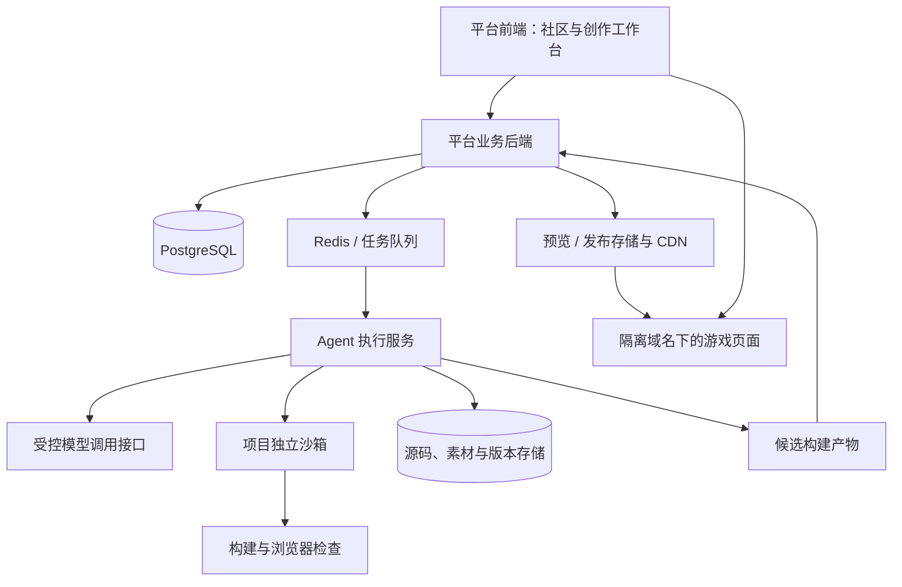

# MYolGame 第一版产品与技术方案

日期：2026-11-06。状态：待实施的初版设计。

## 1. 产品目标与边界

用户输入内置提示词或自定义需求，由云端 Agent 创建独立游戏项目。用户通过浏览器试玩并提出修改，满意后下载成品，或发布到社区供其他用户游玩、收藏与下载。

第一版要验证三个问题：生成结果能否玩，修改能否满足需求，发布的作品是否有人愿意玩。奖励系统已移出范围。

| 纳入第一版 | 后续考虑 |
| --- | --- |
| 2D 单机 HTML5 游戏 | 复杂 3D、多人联机 |
| 提示词创作、持续修改、版本回退 | 多 Agent 团队协作 |
| 云端开发与静态游戏托管 | 每个游戏自定义后端 |
| 浏览、搜索、收藏、举报、基础审核 | 评论、私信、关注、个性化推荐 |
| 游戏包下载、创作者源码下载 | Windows/Android 原生安装包 |
| 基础额度限制与消耗记录 | 付费订阅、广告、奖金、提现 |

第一阶段先实现打砖块一种游戏，跑通完整链路；随后扩充贪吃蛇、平台跳跃、跑酷、俯视角射击和简单塔防。示例提示词绑定经过验证的模板，自定义需求允许修改规则和增加机制。超出范围的需求先展示简化方案，由用户选择后执行。

## 2. 用户流程与页面

创作流程：登录 → 新建项目 → 输入需求 → 查看并确认游戏规格 → 生成 → 试玩 → 对话修改 → 保存版本 → 选择交付方式。

默认生成私有项目。创作者可以选择私有保存、链接分享、社区公开。链接分享不进入社区列表，但持有链接者可以访问，不作为保密机制。社区公开需基础检查和人工审核。

玩家流程：社区首页 → 搜索或分类 → 游戏详情 → 在线游玩 → 收藏、下载或反馈问题。

| 页面 | 核心内容 |
| --- | --- |
| 首页 `/` | 最新公开游戏、编辑精选、分类和搜索 |
| 创作入口 `/create` | 示例提示词、自定义输入、支持范围 |
| 工作台 `/projects/:id` | Agent 对话、实时进度、试玩、版本、发布和下载 |
| 我的项目 `/projects` | 私有草稿、已发布作品、继续开发、删除 |
| 游戏详情 `/games/:id` | 介绍、作者、操作说明、游玩、收藏、下载、举报 |
| 作者主页 `/users/:id` | 个人介绍和公开作品 |
| 管理后台 `/admin` | 发布审核、举报、任务失败和用量查看 |

工作台左侧显示对话，中间为游戏试玩区，右侧显示版本和交付操作；窄屏改成标签切换。首版优先桌面创作，手机以游玩为主，只对已验证的游戏提供触屏支持标记。

## 3. 系统组成：前端、业务后端与 Agent 后端



### 3.1 平台前端与 Agent 交互界面

采用 React、TypeScript 和 Vite。社区与工作台属于同一应用，按页面分模块。

- 通过业务 API 创建项目、提交消息和修改任务。
- 通过 SSE 接收任务阶段、工具活动摘要、失败原因和预览就绪事件。
- 展示需求确认、排队、开发、构建、检查、修复和交付状态，不暴露模型内部思考内容。
- 支持任务取消、失败重试和版本回退。
- 发布操作绑定具体版本；源码下载需创作者权限。
- 前端不保存模型密钥，不直接访问执行沙箱。

### 3.2 平台业务后端

采用 Node.js、TypeScript、Fastify 和 PostgreSQL。负责账号登录、项目权限、对话持久化、任务调度、版本、审核发布和社区数据。

首版账号使用邮箱密码登录，密码采用可靠的密码哈希实现；会话使用 HttpOnly Cookie。管理权限独立校验。具体依赖版本实施时选择并锁定。

后端提供任务事件订阅、预览授权、下载鉴权、限额检查以及发布记录。长任务异步执行，用户断开网页不会导致任务丢失。

### 3.3 Agent 执行服务

采用独立 Node.js/TypeScript Worker，消费任务队列。首版使用一个开发 Agent，通过工具调用完成工作，模型供应商经统一适配接口接入，具体供应商待确定。

Agent 工作顺序：

1. 读取项目需求、结构化规格、基础版本、目录清单和相关文件。
2. 形成当前任务计划与验收项，限制在用户授权范围内。
3. 新建项目时选择模板；修改项目时从指定基础版本恢复工作副本。
4. 编辑源码和允许的资源，使用固定依赖执行构建。
5. 启动测试浏览器，收集截图、控制台错误、输入响应和可验证的游戏状态。
6. 根据证据修复；达到尝试次数、时间或用量上限即停止并保存诊断。
7. 提交不可变的候选版本、构建产物、修改摘要和检查结果。

Agent 工具包括受限文件读写、模板与素材读取、受限构建命令、浏览器操作、版本快照和产物提交。业务发布、账号管理和平台数据库访问不作为 Agent 工具开放。

项目长期记忆来自数据库和版本存储中的规格、确认决定、修改摘要与源码；不依赖模型会话永久记住历史。新任务只加载必要上下文，控制调用成本。

### 3.4 生成游戏的前后端

生成项目采用 Phaser、TypeScript 和 Vite，输出可静态托管的 HTML/CSS/JavaScript 及素材。每个游戏独立保存源码、资源和依赖锁文件。

首版游戏不生成自定义后端。本地存档使用浏览器存储，并提供不可用时的降级处理；云存档和排行榜暂缓。社区账号、收藏和发布属于平台后端。

## 4. 任务、版本与可靠性

任务状态：`queued → running → building → checking → succeeded`。检查失败可进入 `repairing` 再构建；任何执行阶段均可进入 `failed`、`cancelled` 或 `timed_out`。

- 同项目最多一个变更任务执行。执行中收到的新需求保存为待处理消息，当前任务结束后再形成下一任务，防止无意自动执行新需求。
- 任务记录 `base_version_id`，完成时检查项目版本是否发生变化，避免覆盖回退结果。
- 任务创建支持幂等键；Worker 使用租约、心跳与项目锁，重试不得产生重复版本或重复发布。
- 取消时终止沙箱任务并记录结果，不改变已确认版本。
- 沙箱临时文件不作为唯一数据源；源码快照和任务状态持久保存。
- 崩溃后的任务标记中断，清理旧沙箱和失效锁；按预算从最近有效快照重试，不能假定原进程仍在。
- 候选版本、工作台选中版本、公开发布版本分别记录。草稿修改不会改变公开游戏。
- 回退产生一条可追踪记录；公开版回退也需明确的发布更新操作。

每个版本记录父版本、需求摘要、源码位置、产物位置与哈希、依赖锁文件、检查结果和创建任务。发布记录单独绑定版本，游戏的公开链接保持稳定。

## 5. 首版数据结构

| 实体 | 主要字段 |
| --- | --- |
| users / sessions | 账号、密码哈希、角色、会话到期时间 |
| projects | 所有者、标题、游戏规格、当前版本、项目状态 |
| messages | 项目、角色、消息内容、关联任务、时间 |
| tasks | 项目、基础版本、状态、幂等键、预算、租约、错误摘要 |
| task_events | 任务、递增序号、事件类型、数据、时间 |
| versions | 项目、父版本、源码与产物位置、检查结果、哈希 |
| games / releases | 公开资料、可见性、下载开关、审核状态、发布版本 |
| favorites | 用户、游戏，组合唯一约束 |
| reports / moderation_actions | 举报目标、原因、处理状态、操作记录 |
| usage_records | 任务、模型用量、沙箱运行时间、存储用量 |

源码和资源进入对象存储，数据库保存索引与状态。统计作为运营参考，首版不关联奖励。项目删除时撤销访问，排队清理关联文件；保留期在上线前配置并告知用户。

## 6. 主要 API 草案

所有项目接口校验所有权，管理接口校验角色；不能仅凭项目 ID 访问。以下接口为设计目标，尚未实现。

| 方法与路径 | 用途 |
| --- | --- |
| `POST /api/auth/register`、`POST /api/auth/login` | 注册和登录 |
| `POST /api/auth/logout`、`GET /api/me` | 退出和查询会话 |
| `POST /api/projects`、`GET /api/projects` | 创建和列出自己的项目 |
| `GET /api/projects/:id` | 项目、规格和当前状态 |
| `POST /api/projects/:id/messages` | 保存需求或反馈 |
| `POST /api/projects/:id/tasks` | 从指定版本创建生成或修改任务 |
| `GET /api/tasks/:id` | 查询任务和结果 |
| `GET /api/tasks/:id/events` | SSE 订阅，按事件序号支持断线续传 |
| `POST /api/tasks/:id/cancel` | 请求取消 |
| `GET /api/projects/:id/versions` | 列出版本 |
| `POST /api/projects/:id/restore` | 恢复指定版本为工作基础 |
| `POST /api/projects/:id/preview` | 获得绑定版本的临时预览授权 |
| `POST /api/projects/:id/releases` | 提交指定版本及可见性，公开版进入审核 |
| `GET /api/projects/:id/source` | 创作者源码包 |
| `GET /api/games`、`GET /api/games/:id` | 浏览与详情 |
| `GET /api/games/:id/download` | 根据下载开关提供游戏包 |
| `PUT /api/games/:id/favorite`、`DELETE /api/games/:id/favorite` | 幂等收藏和取消 |
| `POST /api/games/:id/reports` | 举报 |
| `POST /api/admin/releases/:id/review` | 审核发布与记录理由 |

预览事件示例：`task_id`、`sequence`、`stage`、`message`、`version_id`。预览地址由鉴权接口提供，不把长期有效的私有文件链接写进公开事件或日志。

## 7. 隔离与交付

- 本机可使用 Docker Compose 运行业务依赖；面向外部用户执行生成代码时，使用专用执行节点和经过验证的沙箱方案，不能把普通容器直接等同于完整安全边界。
- 不向沙箱挂载宿主机 Docker Socket、用户主目录或业务服务凭据。限制 CPU、内存、进程、磁盘、执行时间和网络出口。
- 固定依赖与构建命令，首版不允许 Agent 任意安装依赖或运行生成代码中的安装脚本。
- 模型调用由受控服务代理；构建与测试浏览器也在执行隔离范围内，不能在业务服务器上直接运行。
- 游戏使用独立站点域名，与平台认证 Cookie 隔离，结合受限 iframe、CSP 和最小网络权限。私有预览绑定短期令牌与版本。
- Agent 可以产出预览，公开发布必须由创作者明确发起，公开上架由管理员审核。
- 源码包仅创作者可取；玩家是否能下载构建包由创作者设置。浏览器游戏文件本身会发送到玩家设备，不能承诺前端代码保密。
- 交付包包含构建产物、操作说明、资源来源与许可说明；源码包额外包含锁文件、启动构建说明。首版默认通过静态 HTTP 服务运行，不承诺双击 HTML 离线可玩。

## 8. Ubuntu 开发与云端部署

在 `/home/sakara/MYolGame` 独立开发，采用自己的 Git 仓库，与 ROS 工程隔离。开发时不要求安装或启动 ROS。

建议代码布局（待实施）：

```text
MYolGame/
  apps/web/                  平台前端与 Agent 工作台
  apps/api/                  平台业务后端
  services/agent-worker/     Agent 任务执行服务
  packages/contracts/       API、事件、任务和游戏规格类型
  packages/game-sdk/        游戏启动、重启、诊断等统一约定
  templates/                固定版本的基础游戏模板
  infra/                    本地开发与部署配置
  docs/                     产品、接口和运维文档
```

本地：前端、API 和 Worker 使用项目锁定的 Node.js 环境；数据库、Redis 和对象存储兼容服务通过容器提供。仅开发者受控测试使用本地执行环境。

云端试用：业务节点运行反向代理、Web、API 和调度服务；独立执行节点运行 Agent 沙箱；数据库和对象存储持久化，备份放到独立位置。公开游戏经静态托管/CDN 分发，玩游戏不需要 Agent 持续运行。

至少区分平台域名与游戏域名。实际云厂商、域名、区域、模型供应商和实例规格在部署阶段选择，本方案不包含购买或部署动作。

## 9. 用量控制与观测

首版不实现付费系统，但必须记录成本并有管理员可配置的限制。建议试用初值：每账号一个执行中任务，每项目一个变更任务；单任务最多两轮自动修复、最长十分钟。初值待实测调整，不是耗时承诺。

模型 token、请求数、执行时间、项目数量和文件体积均设硬上限；达到上限停止，保留上一有效版本并解释原因。取消任务也记录已经发生的消耗。

日志关联用户、项目和任务 ID，记录阶段耗时、错误分类与资源消耗，不记录密钥或无必要的完整用户源码。重点观测排队时间、可试玩率、修改成功率、单任务成本和公开游戏加载失败率。

## 10. 实施里程碑与验收

| 阶段 | 实施内容 | 完成标准 |
| --- | --- | --- |
| M0 工程骨架 | Web/API/Worker、数据库、队列、登录、事件协议 | 能创建鉴权任务，刷新后恢复状态；模拟任务明确标识 |
| M1 首个真实闭环 | 打砖块模板、真实模型工具调用、构建与浏览器检查 | 自定义需求能改变实际代码；可试玩并再次修改；可下载源码 |
| M2 项目可靠性 | 持久化快照、版本回退、取消、预算、崩溃恢复 | 失败不破坏上一版，重试不重复提交；用户不能读写他人项目 |
| M3 社区发布 | 发布审核、详情、搜索、收藏、举报、下载 | 私有项目不泄露；公开链接可玩；草稿更新不影响公开版本 |
| M4 扩充与试用 | 扩展模板、手机适配、部署、备份恢复 | 固定提示词集完成评估，目标设备试玩通过，能从备份恢复 |

验收使用固定需求与修改案例，并保存产物、截图和日志。至少覆盖启动、操作、计分、结束、重启及一个失败恢复场景。游戏测试接口可辅助检查，但不能只依赖生成代码自己报告成功。

自动检查通过只代表已验证的技术行为；游戏是否有趣、操作手感和需求符合度需要人工试玩。评估基线先记录至少二十组固定需求及修改任务，再据此确定对外质量和耗时承诺。

## 11. 第一项开发任务

优先完成 M0 和 M1：建立独立工程，创建一个带真实 Agent 调用的打砖块项目，让用户在工作台提出“增加挡板宽度”“增加第二关”等要求，看到代码、试玩版本和版本记录实际变化。

这一闭环验收通过后再建设完整社区，避免平台页面已齐全但游戏开发链路仍停留在演示状态。
